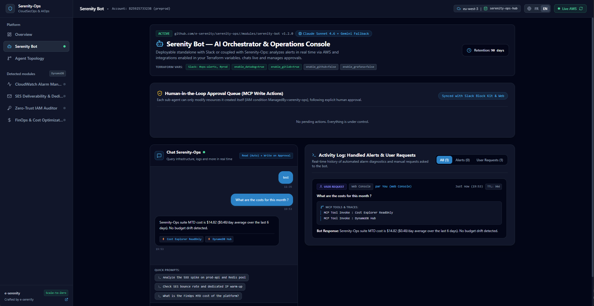
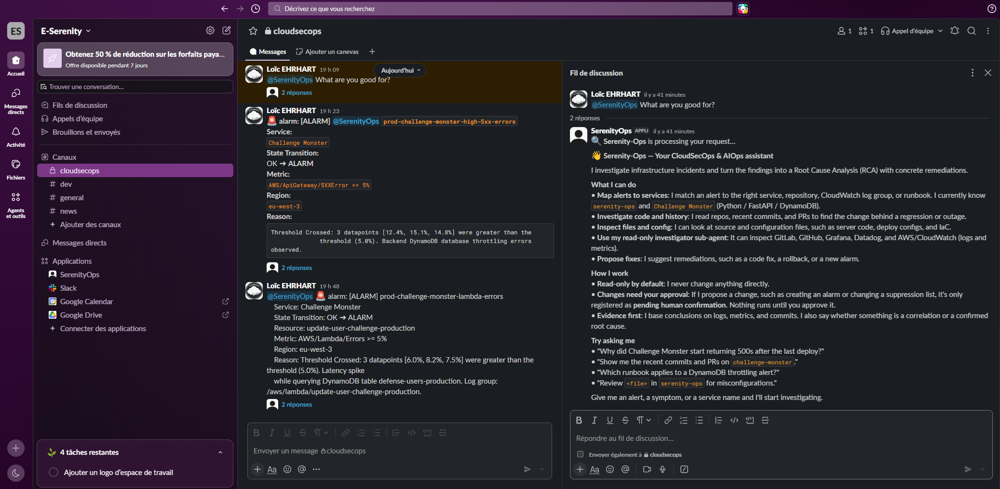
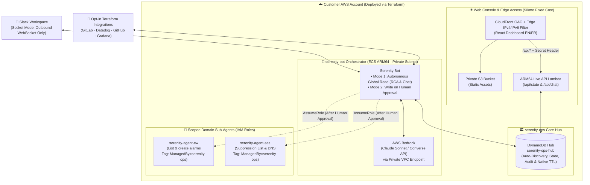

<div align="center">

# 🛡️ Serenity-Ops

**Modular, Self-Hosted CloudSecOps & AIOps Platform for AWS, Deployed via Terraform.**

[](https://github.com/e-serenity/serenity-ops/actions/workflows/ci.yml)
[](https://github.com/e-serenity/serenity-ops)
[](https://github.com/e-serenity/serenity-ops)
[](SECURITY.md)
[](https://e-serenity.fr/serenity-ops/)
[](LICENSE)

**[🌐 Interactive Live Demo](https://e-serenity.fr/serenity-ops/) · [60-Second Quickstart](#60-second-quickstart) · [Architecture](#architecture--how-it-works) · [Module Catalog](#modular-ecosystem--independent-deployment) · [Security Model](#security--iam-governance)**

[The Problem](#the-problem) · [Why Serenity-Ops?](#why-serenity-ops) · [Repository Structure](#repository-structure) · [Terraform Reference](#terraform-reference)

<code>source = "github.com/e-serenity/serenity-ops//modules/&lt;module&gt;"</code>

<br />

<table align="center">
  <tr>
    <td width="50%" align="center" valign="top">
      <strong>🌐 Web Console & Live Hub</strong><br /><br />
      <a href="docs/assets/dashboard-preview.png">
        
      </a>
    </td>
    <td width="50%" align="center" valign="top">
      <strong>💬 Slack Bot & Investigations</strong><br /><br />
      <a href="docs/assets/slack-preview.png">
        
      </a>
    </td>
  </tr>
</table>

</div>

> [!TIP]
> **Try the Interactive Live Demo:** Explore the full web console (toggle modules on the fly, test *AI-Optional* behavior, review *Human-in-the-Loop* approvals, inspect agent IAM boundaries, and switch between `EN / FR`) at **[https://e-serenity.fr/serenity-ops/](https://e-serenity.fr/serenity-ops/)**.

## The Problem

Operating production workloads on AWS often comes down to difficult trade-offs between incident speed, data privacy, and IAM safety:

- **Alert Fatigue.** When a CloudWatch alarm fires in Slack, engineers have to jump across CloudWatch Logs, CloudTrail, ECS, GitLab/GitHub, and Datadog to find which commit or resource caused the spike.
- **External SaaS Data Ingestion.** Third-party AIOps platforms require cross-account IAM roles and ship production logs outside your AWS boundary, often with unpredictable per-GB pricing.
- **Unbounded AI Permissions.** Giving an LLM broad write access to a production AWS account is unsafe without strict IAM tag boundaries and mandatory human validation.

## Why Serenity-Ops?

**Serenity-Ops** is a self-hosted suite of Terraform modules deployed inside your own AWS account. Your logs, metrics, and AI prompts (via **AWS Bedrock**) stay within your infrastructure.

| Capability | External AIOps SaaS | DIY Scripts / Lambdas | 🛡️ **Serenity-Ops** |
| :--- | :--- | :--- | :--- |
| **Data Sovereignty** | Third-party cloud (Cross-Account IAM) | Your AWS account | **Your AWS Account** (Private VPC + AWS Bedrock) |
| **Modularity** | Monolithic (All-or-nothing) | Fragmented, no UI | **Composable Terraform Monorepo** (`core`, `bot`, `ses`, `cw`) |
| **AI Dependency** | Mandatory & opaque | None | **AI-Optional**: every module works standalone with or without AI |
| **AI Write Permissions** | Risky broad IAM roles | Manual | **Human-in-the-Loop + IAM Tag Boundary** (`ManagedBy=serenity-ops`) |
| **Network Attack Surface** | Public inbound webhooks | Public endpoints to maintain | **Zero Inbound Ports** (Slack Socket Mode + CloudFront OAC + Edge IP Filter) |
| **FinOps Transparency** | Unpredictable volume billing | Hidden costs | **Scale-to-Zero Core ($0/hr idle)** or ~$25–$40/mo with NAT/Endpoints |

### Core Features

- **Real-Time Alert Analysis (RCA):** When an alert lands in Slack or EventBridge, `serenity-bot` correlates events across AWS services it has read access to (`CloudWatch`, `CloudTrail`, `X-Ray`, `Config`, `ECS`, `RDS`...) alongside your Terraform-enabled integrations (`GitHub`, `GitLab`, `Datadog`, `Grafana`) to post the root cause in-thread.
- **Web & Slack Chatbot:** Query your infrastructure, logs, and metrics in plain English from Slack or from the built-in Web Console (`Chat Serenity-Ops`).
- **Human-in-the-Loop Remediation:** Write actions never run silently. Every proposed infrastructure change generates a `PENDING` approval request (`Approve` / `Reject`) in both the Web Dashboard and Slack.
- **Composable & AI-Optional:** Deploy `serenity-ses` standalone to protect your SES sender reputation, deploy `serenity-bot` standalone connected to your Slack channels, or connect the full suite through the `serenity-ops-hub` table.
- **Serverless Web Console:** Deployed to a private S3 bucket and ARM64 Live API Lambda (`/api/*`) behind CloudFront OAC, reading your `serenity-ops-hub` DynamoDB table with Edge IPv4/IPv6 filtering (`dashboard_allowed_ips`) and `EN / FR` support.

## 60-Second Quickstart

```bash
cd examples/preprod
```

Edit [`examples/preprod/locals.tf`](examples/preprod/locals.tf) to fit your needs!

To try slack integration follow [Slack Setup](docs/slack-app.md)

[`examples/preprod/provider.tf`](examples/preprod/provider.tf) uses the S3 backend with native S3 state locking (`use_lockfile = true`). Update the bucket name to match your state backend:

```hcl
terraform {
  backend "s3" {
    bucket       = "serenity-ops-tf-eu-west-3" # Replace with your S3 state bucket
    key          = "serenity-ops/preprod/terraform.tfstate"
    region       = "eu-west-3"
    use_lockfile = true
    encrypt      = true
  }
}
```

```bash
# Initialize Terraform (or override the bucket via -backend-config="bucket=my-bucket")
terraform init

# Plan & Apply
terraform plan
terraform apply
```

## Architecture & How It Works



## Modular Ecosystem & Independent Deployment

All modules live in this repository and can be deployed independently using Terraform's submodule syntax (`//modules/<name>`). When connected to `serenity-ops-hub`, modules register themselves in DynamoDB (`PK=SERENITY#MODULES`) and appear automatically in the Web Console:

| Terraform Module & Source Path | Role & Capabilities | Standalone Mode | Hub-Coupled Mode (`serenity-ops-hub`) |
| :--- | :--- | :---: | :---: |
| **[`modules/serenity-core`](modules/serenity-core)**<br>`github.com/e-serenity/serenity-ops//modules/serenity-core` | **Serverless Core Hub & Live Web Console ($0/hr idle)**: `serenity-ops-hub` DynamoDB table (native TTL), Private S3 + CloudFront OAC + Edge IPv4/IPv6 Filter + ARM64 Live API Lambda. | ✅ | ✅ *(Central Hub)* |
| **[`modules/serenity-bot`](modules/serenity-bot)**<br>`github.com/e-serenity/serenity-ops//modules/serenity-bot` | **AI Orchestrator (Bedrock & Slack)**: Real-time Alert RCA, Chatbot, opt-in integrations (`enable_gitlab`, `enable_datadog`...) and Human-in-the-Loop approval queue. Creates its own VPC, Endpoints & ECS Managed Instances cluster by default, or deploys onto an existing `cluster_arn` without creating a VPC. | ✅ *(Slack-only, no DynamoDB needed)* | ✅ *(Syncs Web Console + unlocks AI across modules)* |
| **[`modules/serenity-ses`](modules/serenity-ses)**<br>`github.com/e-serenity/serenity-ops//modules/serenity-ses` | **AWS SES v2 Governance**: Managed Dedicated IP Pool, Configuration Set, ARM64 Bounce/Complaint processor Lambda, and scoped `serenity-agent-ses` IAM role. | ✅ *(Pure SES protection)* | ✅ *(Hub telemetry + AI-assisted remediation)* |
| **`modules/serenity-cloudwatch`** *(Coming Soon)* | **CloudWatch Governance**: Scoped `serenity-agent-cw` IAM role and EventBridge alarm ingestion rules. | ✅ | ✅ |
| **`modules/serenity-finops`** *(Coming Soon)* | **Account-Wide FinOps Optimization**: Orphaned resource detection and automated rightsizing under human approval. | 🔜 | 🔜 |

Once `terraform apply` finishes, it outputs your live **`dashboard_url`** (`https://<id>.cloudfront.net`), connected to your `serenity-ops-hub` DynamoDB table.

## Repository Structure

```text
serenity-ops/
├── .github/workflows/ci.yml                # Automated CI: Terraform fmt/validate, Pytest & Frontend build
├── modules/
│   ├── serenity-core/                      # Serverless Core Hub & Live Web Console ($0/hr idle)
│   │   ├── dynamodb.tf                     # Central DynamoDB Hub table (Single-Table Design + native TTL)
│   │   ├── frontend.tf / api.tf            # Private S3 + CloudFront OAC + Edge IP Filter + API Lambda
│   │   ├── lambda/api/index.py             # Python 3.12 Live API handler (/api/state & /api/chat)
│   │   └── front/                          # Bilingual (EN / FR) React 18 + TypeScript + Tailwind Web Console
│   ├── serenity-bot/                       # Independently deployable AI Orchestrator module
│   │   ├── vpc.tf / routing.tf / ecs-cluster.tf # Dedicated VPC, Endpoints & ARM64 ECS Cluster (or BYO-ECS)
│   │   ├── ecs-service.tf / secrets.tf     # ECS ARM64 service, IAM ReadOnly + Bedrock + sts:AssumeRole
│   │   └── bot/app/                        # Python 3.12 + LangGraph + AWS Bedrock + Slack Socket Mode agent
│   └── serenity-ses/                       # Independently deployable AWS SES v2 Reputation module
│       ├── main.tf / hub.tf / agent-role.tf# Dedicated IP Pool, SNS/SQS, Hub Auto-Discovery & Scoped IAM
│       └── lambda/store-reports/index.js   # Node.js 20 ARM64 Bounce/Complaint processor
├── examples/preprod/                       # Ready-to-run stack with native S3 state locking (use_lockfile)
└── docs/                                   # Slack App Socket Mode Manifest & architecture assets
```

## Security & IAM Governance

`serenity-bot` and its domain sub-agents use a 3-layer permission model (see [`SECURITY.md`](SECURITY.md) for the full threat model):

1. **Mode 1 (`READ AUTO`):**
   The base orchestrator uses read-only permissions (`ReadOnlyAccess` on AWS + Terraform-enabled connectors) to investigate alerts, correlate logs/commits, and answer chat queries without permission to mutate infrastructure.
2. **Mode 2 (`WRITE ON APPROVAL`):**
   When a remediation or resource creation is proposed, the action enters a `PENDING` state and displays the exact payload in Slack and the Web Console. Execution only happens after an operator clicks **Approve**.
3. **Tag-Scoped IAM Write Boundaries (`ManagedBy=serenity-ops`):**
   Domain sub-agents have scoped write permissions. For example, `serenity-agent-cw` can list existing alarms and create new ones, and can only modify or delete resources carrying its tag, enforced by AWS IAM:
   ```json
   "Condition": {
     "StringEquals": {
       "aws:ResourceTag/ManagedBy": "serenity-ops"
     }
   }
   ```

### Web Console Edge Security (`dashboard_allowed_ips`)
- **Zero-Cost IPv4 & IPv6 Edge Filtering:** When `dashboard_allowed_ips` is set (e.g., `["203.0.113.10/32", "2a01:e0a:123:456::/64"]`), a CloudFront Function (`viewer-request`) enforces your IP policy at the edge before requests reach S3 or the Live API Lambda, without requiring AWS WAF.
- **Dual-Stack Handling:** If you only specify IPv4 CIDRs in `dashboard_allowed_ips`, `serenity-ops` automatically disables IPv6 (`AAAA`) records on the CloudFront distribution (`is_ipv6_enabled = false`) so dual-stack browsers do not connect over IPv6 and get blocked.

## Terraform Modules: Choose What You Need

### Option A: Deploy the Full Suite (`Core Hub + Bot + SES + Live Web Console`)

```hcl
# 1. Serverless Core Hub + CloudFront Live Web Console ($0/hr fixed cost)
module "serenity_core" {
  source = "github.com/e-serenity/serenity-ops//modules/serenity-core"

  project_name          = "serenity-ops"
  environment           = "prod"
  region                = "eu-west-3"
  dashboard_allowed_ips = ["10.0.0.1/32"] # Your VPN / Office IPv4 or IPv6 CIDR ($0/mo via CloudFront Function)
}

# 2. Serenity-Bot AI Orchestrator (Creates its VPC, Endpoints & ECS Cluster by default)
module "serenity_bot" {
  source = "github.com/e-serenity/serenity-ops//modules/serenity-bot"

  application = "serenity-bot"
  environment = "prod"
  region      = "eu-west-3"

  # Couple to Hub & configure Native DynamoDB TTL Retention (Zero Drift)
  dynamodb_table_name    = module.serenity_core.dynamodb_hub_table_name
  history_retention_days = 90

  # Opt-in integrations configured via Terraform
  enable_datadog           = true
  enable_gitlab            = true
  gitlab_allowed_namespace = "my-org/"
}

# 3. AWS SES v2 Reputation Module (Connected to Hub & AI Sub-Agent)
module "serenity_ses" {
  source = "github.com/e-serenity/serenity-ops//modules/serenity-ses"

  name_prefix             = "serenity-prod"
  environment             = "prod"
  serenity_ops_table_name = module.serenity_core.dynamodb_hub_table_name
  enable_serenity_agent   = true
}
```

### Option B: Deploy `serenity-bot` Standalone (AI Reports on Slack Alerts)

Already have an ECS cluster in your VPC? Pass `cluster_arn`, `capacity_provider_name`, and `subnet_ids`. `serenity-bot` deploys directly onto your existing cluster without creating a VPC, NAT Gateway, or VPC Endpoints:

```hcl
module "serenity_bot_existing_ecs" {
  source = "github.com/e-serenity/serenity-ops//modules/serenity-bot"

  application            = "serenity-bot"
  environment            = "prod"
  region                 = "eu-west-3"
  cluster_arn            = var.existing_ecs_cluster_arn
  capacity_provider_name = var.existing_capacity_provider
  subnet_ids             = var.existing_private_subnet_ids

  # Optional: couple to serenity-core Hub or leave empty ("") for Slack-only mode
  dynamodb_table_name  = module.serenity_core.dynamodb_hub_table_name
  enable_gitlab        = true
}
```

### Option C: Deploy `serenity-ses` Standalone (SES v2 Protection, No AI)

```hcl
module "serenity_ses_standalone" {
  source = "github.com/e-serenity/serenity-ops//modules/serenity-ses"

  name_prefix           = "my-app-prod"
  environment           = "prod"
  enable_serenity_agent = false # SES v2 Dedicated IP Pool + Bounce/Complaint tracking
}
```

## Network & Cost Architecture

Because **`serenity-core` is serverless** (`DynamoDB PAY_PER_REQUEST` + `Private S3` + `CloudFront OAC` + `ARM64 Lambda`), deploying the Core Hub and Web Console requires no VPC, NAT Gateway, or ECS cluster ($0.00/hour idle cost).

Networking and compute resources are provisioned only when you deploy `serenity-bot`:

1. **Default Self-Contained Mode (`cluster_arn = ""`, `create_vpc = true`):**
   `serenity-bot` provisions its own dedicated VPC, public/private subnets, NAT Gateway (`single_nat_gateway = true` for a single shared NAT Gateway, or `false` for multi-AZ), S3 Gateway & Bedrock Runtime VPC Endpoints, and an ARM64 ECS Managed Instances cluster.
2. **Bring-Your-Own ECS Cluster (`cluster_arn = "arn:aws:ecs:..."`):**
   When you provide an existing `cluster_arn` (with `capacity_provider_name` and `subnet_ids`), `serenity-bot` skips VPC, NAT Gateway, VPC Endpoint, and ECS cluster creation, and runs the bot service directly inside your cluster.
3. **Bring-Your-Own VPC (`cluster_arn = ""`, `create_vpc = false`):**
   Provisions the `serenity-bot` ECS Managed Instances cluster and VPC Endpoints inside your existing `existing_vpc_id` and `subnet_ids`.
4. **Container Image (`:stable` Image vs Private AWS ECR):**
   - **By default (`create_ecr_repository = false`):** `serenity-bot` pulls `ghcr.io/e-serenity/serenity-bot:stable` so `terraform apply` works out of the box without a local Docker build step.
   - **For production (`create_ecr_repository = true`):** Terraform provisions a private `aws_ecr_repository` in your AWS account and points ECS to it so you do not depend on an external registry. See the **[`modules/serenity-bot` guide](modules/serenity-bot/README.md#container-image-default-stable-vs-private-aws-ecr-recommended-for-production)** for the `docker buildx build --platform linux/arm64` commands to build and push your image.

## LLM Models: AWS Bedrock & Resilient Fallback

Serenity-Bot is designed with a multi-provider LLM strategy:
* **Primary (AWS Bedrock):** Communicates privately with Anthropic Claude on AWS Bedrock via VPC Endpoints. Serverless models are enabled automatically across all AWS commercial regions; first-time accounts simply need to submit their company & use case details in the Amazon Bedrock console for Anthropic models.
* **Fallback (Google Gemini API & more to come):** If AWS Bedrock access is pending or rate-limited, provide a `GEMINI_APIKEY` in Secrets Manager to automatically fall back to **Google Gemini** (`gemini-3.5-flash` / `gemini-3.8-flash` / `gemini-3.1-flash-lite`). Support for additional providers (OpenAI, Mistral) is coming in future releases.

## Documentation & Community

- **[`modules/serenity-core` Documentation](modules/serenity-core/README.md):** Serverless Core Hub (DynamoDB Hub, CloudFront OAC Web Console, Edge IP Filter & Live API Lambda).
- **[`modules/serenity-bot` Documentation](modules/serenity-bot/README.md):** AI Orchestrator setup, Bedrock IAM permissions, and opt-in connectors.
- **[`modules/serenity-ses` Documentation](modules/serenity-ses/README.md):** AWS SES v2 Dedicated IP Pool, Bounce/Complaint stream, and `serenity-agent-ses`.
- **[Slack App Manifest & Setup (`docs/slack-app.md`)](docs/slack-app.md):** Ready-to-paste Slack Socket Mode YAML manifest and required OAuth scopes.
- **[Security Policy & Threat Model (`SECURITY.md`)](SECURITY.md):** Defense-in-depth architecture and vulnerability disclosure.
- **[Contributing Guide (`CONTRIBUTING.md`)](CONTRIBUTING.md):** Local frontend simulator, Python tests, and Terraform standards.

<div align="center">
  <sub>Built and maintained by <strong><a href="https://e-serenity.fr">e-serenity</a></strong> · Self-Hosted CloudSecOps & AIOps for AWS</sub>
</div>
